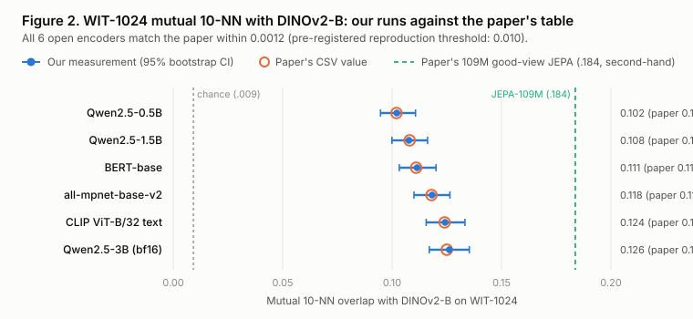
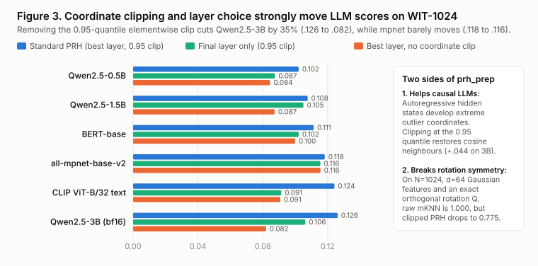
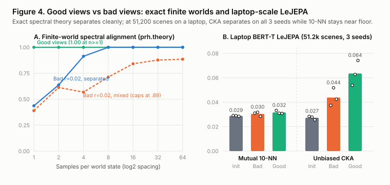

# Do good views make separate encoders align, and do the published baselines hold up?

**2026-11-06 (draft).** Every number we measured here comes from runs in this repo (`paper/numbers.json`); numbers rebuilt from the authors' released CSVs are marked second-hand. The full write-up is `paper/report.md`, and every claim has a row in `paper/claims.md`.

## The short version

I tested [*Proving and Improving the Platonic Representation Hypothesis with JEPAs*](https://github.com/galilai-group/prh-proof) (`arXiv:2610.39302`, Balestriero and LeCun, released 2026-10-30, MIT licence) across three phases on one 16 GB Apple M4 Mac with no paid compute: auditing the upstream codebase and released CSVs, independently extracting and scoring 6 open text encoders against `DINOv2-B` on the 1,024-pair WIT-1024 benchmark, and running exact finite-world checks plus 6 controlled laptop neural LeJEPA training runs (`BERT-T`, 11.3M parameters, `51,200` COCO scenes per run).

| Phase | What we ran or checked | Result | Key numbers |
|---|---|---|---|
| **Phase 1: Upstream repo & CSVs** | 139 `pytest` tests on CPU; 345-row `runs.csv`; all README headlines vs `paper/data/*.csv`; NumPy vs PyTorch metric cross-check | **135/139 pass**; CSVs rebuild all headlines save 1 `typed` table | 3 skips (optional deps); 1 `pytest 9.2` 0-d tensor error (`< 1e-16` math diff); `41.67x` samples = **`13.89x` tokens**; scaling RMSE `0.0093` (85 random) / `0.0109` (all 88) |
| **Phase 2: WIT-1024 baselines** | `DINOv2-B` + 6 open text models (`Qwen2.5-0.5B/1.5B/3B`, `BERT-base`, `mpnet`, `CLIP`) extracted and scored from raw pairs | **6 of 6 reproduced** well inside frozen `0.010` threshold | Max gap **`0.0012`** on mutual 10-NN (`0.1021` to `0.1262`) and **`0.0004`** on unbiased CKA (`0.2916` to `0.3899`) |
| **Phase 3A: Finite worlds** | 20 clustered product worlds (`16` states, `6` nuisances, `k = 5`) + 10-seed sample-density sweeps (`1` to `64` per state) | **Exact separation** under theorem assumptions | `0.0` vs `10.0` (`2k`) cross-modal error in 20/20 worlds; `1.000` alignment at `1` sample/state vs `0.436` for short-reach bad views (`0.885` cap on mixed classes) |
| **Phase 3B: Laptop LeJEPA** | 6 neural `BERT-T` runs (`400` steps x `128` COCO scenes = `204,800` views, seeds `0, 1, 2`), good vs bad views | **Null on 10-NN; 3/3 seeds on CKA** | Mutual 10-NN: `0.0289` init -> `0.0305` bad vs `0.0317` good; unbiased CKA: `0.0273` init -> `0.0439` bad vs **`0.0636` good** (3/3 seeds) |

Machine: a MacBook Air with an Apple M4 chip and 16 GB of unified memory (`macOS-27.0.1-arm64-arm-64bit`; the run JSON files record the OS string and `arm` processor via Python `platform`, while the Mac model and memory are as reported by the owner). Python `3.12.15`, PyTorch `2.15.0`, `transformers` `5.22.1`, `timm` `1.0.31`, `datasets` `5.1.0`, `numpy` `2.5.4`, testing `galilai-group/prh-proof` at `a2b9949fa907d4fbe562742d4b1ffa7205ab7427`.

What I took from it:

- **The authors' code and pretrained baseline numbers are genuinely clean.** All 6 open text encoders we could fit on disk matched their WIT-1024 mutual 10-NN and CKA tables to around the third decimal place, and our independent NumPy metrics matched their PyTorch metrics to floating-point precision (`9.8e-5` on 10-NN from a single tied neighbour edge; `1.0e-8` on CKA).
- **"42x fewer samples" is `41.67x` in samples and `13.89x` in tokens.** In their released `phase_real.csv`, each good-view training sample reads three captions (`128.4` vs `42.8` tokens), giving `38.52B / 2.77B = 13.89x` in tokens. Nearly 14x is still a strong result, and naming both ratios keeps comparisons fair.
- **The PRH benchmark's 0.95-quantile coordinate clip cuts both ways.** Under exact global minimisers, matched world-state marginals and conditionally independent views, the paper's theorems identify representations up to an orthogonal rotation `Q`. Yet `prh_prep` clips individual coordinates at their 0.95 quantile before L2 normalisation: an exact orthogonal rotation of `1024 x 64` Gaussian features drops clipped mutual 10-NN from `1.0000` to **`0.7746`**, while on real causal LLMs removing that clip cuts `Qwen2.5-3B` by **35%** (`0.1262` down to `0.0820`) because causal transformers pack huge outlier activations into a few fixed dimensions.
- **At 51,200 scenes on a laptop, global CKA sees view quality before discrete 10-NN does.** At about `1 / 59` of the smallest run in the authors' scaling grid, discrete 10-NN stayed near random word-overlap initialization (`0.0305` vs `0.0317`), whereas global unbiased CKA separated good views from bad views on all 3 seeds (`0.0636` vs `0.0439`) even though bad views reached lower training invariance loss (`0.328` vs `0.395`) by matching spans of the same caption.
- **Three local traps nearly derailed the runs.** My own first bootstrap shrank the candidate pool to ~63.2% of `N`; a 100.5-megapixel Wikimedia image inside WIT-1024 pushed my first extraction to 19 GB of RAM and disk swap; and seeding an Apple MPS `torch.Generator` inside `stable_pretraining`'s `SlicedEppsPulley` loss deadlocked PyTorch `2.15.0` until that scalar term was moved to CPU.

## Chapter 1: why I built this

On 5 November 2026 I started outlining an experiment on whether joint-embedding predictive models converge toward vision-aligned representations faster than next-token language models. Checking recent releases turned up Balestriero and LeCun's paper and MIT-licensed codebase from six days earlier (`galilai-group/prh-proof`, 30 October 2026), backed by 345 runs and roughly 5,500 GPU-hours. Nobody independent had published a check of it yet.

Rather than throw away the question or pretend one MacBook Air can re-run 5,500 GPU-hours, I turned the repo into an independent replication in the same style as `decision-models` and `rea-study`: freeze `docs/analysis-plan.md` before the first scored run, write my own metric code from scratch, test every claim that fits in 16 GB of memory with zero paid compute, and state plainly what a laptop cannot check.

## Chapter 2: the build

### Freezing the rules first

Before running Phase 1, Phase 2 or Phase 3, I checked and fingerprinted the licences of all 12 external repositories, model checkpoints and datasets in `docs/licences.md`, repaired a sample-shrinkage bug in my initial `bootstrap` implementation, and froze `docs/analysis-plan.md` in commit `44f154d`. That plan fixed the WIT-1024 reproduction tolerance (`0.010` on mutual 10-NN), forbade silent edits to upstream tests, and stated up front that a null `mutual_knn` result at laptop training scale would count as a scale limit rather than a refutation.

### Measuring alignment, and why coordinate clipping surprised me

While writing unit tests for `scripts/metrics.py`, I checked that `mutual_knn` and `unbiased_cka` stay at `1.0000` when a feature matrix `A` is multiplied by a random orthogonal matrix `Q`. They do. Then I ran the same check through `prh_score`, which applies the standard PRH benchmark's 0.95-quantile elementwise coordinate clip (`prh_prep`) before L2 normalisation: on `1024 x 64` Gaussian features, `prh_score` dropped to `0.7746` (`0.9794` on CKA). Coordinate clipping prefers the basis vectors you happen to be written in.

When Phase 2 ran on real models, the reason that heuristic survived became clear: causal LLMs (`Qwen2.5-0.5B`, `1.5B`, `3B`) concentrate extreme activations in a few rogue coordinates, so removing the clip collapses `Qwen2.5-3B` from `0.1262` to `0.0820` and wipes out scaling across model sizes, whereas contrastive `all-mpnet-base-v2` barely notices (`0.1183` to `0.1156`). Layer choice matters almost as much: on all 6 text encoders, `DINOv2-B` peaked at block `10` (mKNN) and block `9` (CKA) rather than its final block `11`.

### What went wrong on a 16 GB Mac, and what I did about it

- **19 GB swap spike on a 100.5-megapixel image (`task-188`).** Calling `list(ds["image"])` on WIT-1024 decoded all 1,024 full-resolution Wikimedia uploads into memory at once, including a `100,512,000`-pixel scan (`DecompressionBombWarning`), alongside `batch_size = 32` MPS buffers at `518x518`. Streaming batches of 8 images, closing each PIL image right away, and auto-cleaning Hugging Face weight blobs (`--cleanup-cache`) brought `DINOv2-B` peak RSS down to `2,220.2 MB` and kept all 6 text models under `3,790.8 MB`.
- **Skipping `Qwen2.5-7B` for disk safety.** `df -h /` showed only `17` to `21 GiB` of free disk space, where a `15.2 GB` `Qwen2.5-7B` weight download plus `~15.2 GB` unified-memory footprint on a 16 GB machine risked filling the drive with swap. I kept `docs/analysis-plan.md` untouched and logged the skip in `NOTES.md`.
- **An Apple MPS generator deadlock (`task-277`).** Phase 3 hung silently on step 1 for 38 minutes because `stable_pretraining`'s `SlicedEppsPulley` calls `torch.Generator(device='mps').manual_seed(...)`, which deadlocks in PyTorch `2.15.0` on MPS. Keeping `BERT-T` and the projector on MPS while running only the scalar `SlicedEppsPulley` test on CPU ran all 6 training jobs and 18 WIT-1024 evaluations cleanly in `35.6` minutes (`2,475.5 MB` peak RSS).

### Limits

- No web-scale retraining (`940M` Recap images, `.184` WIT-1024), no `70B` to `72B` LLM inference, no ImageNet vision JEPAs, and no captioner training; those headlines were audited from `paper/data/*.csv` only and are marked second-hand.
- Six of seven planned open text encoders were run (`qwen7b` skipped for disk space), against a single vision reference (`DINOv2-B`).
- Our 6 laptop LeJEPA runs (`51,200` COCO scenes, `204,800` views) are about `1 / 59` of the smallest run in the authors' scaling grid (`BERT-S`, `3M` samples) and `1 / 844` of the `21.6M`-sample run behind the "42x" headline (counting 8 views per sample), testing only early optimization on everyday photo captions rather than encyclopedic Wikipedia text.
- Theorems 1 to 4 are verified here only in exact finite spectral worlds under matched world-state marginals and conditionally independent nuisances, not under neural non-convex optimization or mismatched modality marginals.
- One table in the paper (`tab:captioner_scale`, `.838` COCO CIDEr) is marked `typed` in `docs/reproduce.md` and has no CSV in `paper/data/`.

## Claims ledger

Every claim on this page, and where its evidence lives. All 24 claims in full: `paper/claims.md`.

| Claim | Evidence |
|---|---|
| 135 of 139 upstream `pytest` tests pass on CPU; 3 skip for optional packages; 1 fails on a `pytest 9.2.0` 0-d tensor check while CKA matches to `< 1e-16` | `results/phase1.json` (`pytest_suite`); `results/raw/phase1_pytest_slow.txt` (`C1, C2`) |
| `paper/runs.csv` lists 345 unique tags (`321` completed, `18` cancelled, `6` failed); all README headlines rebuild from CSVs save `typed` `.838` COCO CIDEr | `scripts/phase1_audit.py`; `results/phase1.json` (`runs_csv`, `headline_numbers`) (`C3 to C7`) |
| "42x fewer samples" (`21.6M` vs `900M`, `41.67x`) is `13.89x` in tokens (`2.77B` vs `38.52B`) | `vendor/prh-proof/paper/data/phase_real.csv`; `results/phase1.json` (`C4`) |
| `scripts/metrics.py` matches `prh.metrics` (`<= 9.8e-5` mKNN, `<= 1.0e-8` CKA); orthogonal rotation drops `prh_prep`-clipped Gaussian 10-NN from `1.0000` to `0.7746` | `tests/test_metrics.py`; `results/phase1.json`; `results/phase2_wit1024.json` (`C8, C9`) |
| 6 of 6 open text encoders on WIT-1024 match the paper within `0.0012` (mKNN) and `0.0004` (CKA); removing 0.95-clip cuts `Qwen2.5-3B` from `0.1262` to `0.0820` | `scripts/extract.py`; `scripts/align.py`; `results/phase2_wit1024.json` (`C10 to C14`) |
| Exact finite worlds separate `0.0` vs `10.0` error (`20/20` worlds); 6 laptop `BERT-T` LeJEPA runs are null on 10-NN (`0.0305` vs `0.0317`) and separate `3/3` seeds on CKA (`0.0636` vs `0.0439`) | `scripts/phase3_views.py`; `results/phase3_views.json` (`C15 to C19`) |
| Analysis plan frozen at `44f154d`; all 12 external licences fingerprinted; memory spike, `qwen7b` disk skip and MPS generator deadlock logged | `docs/analysis-plan.md`; `docs/licences.md`; `NOTES.md` (`C20 to C24`) |
