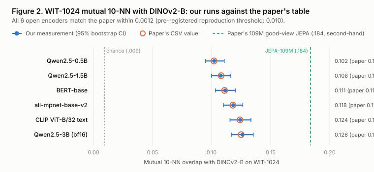

# PRH-JEPA study

An independent test of [*Proving and Improving the Platonic Representation Hypothesis with JEPAs*](https://github.com/galilai-group/prh-proof) (`arXiv:2610.39302`, Balestriero and LeCun, released 2026-10-30, MIT licence).

The paper argues that two encoders trained separately, one per modality, with a JEPA objective (predicting one view of a scene from another view inside internal embedding space) recover the same representation up to one orthogonal rotation at exact global minimisers when world-state marginals match and views are conditionally independent given the scene ("good views", such as two captions of one photograph). It also reports that a 109M-parameter text JEPA aligns better with vision models than language models up to 72B parameters.

With no independent replication published yet, this study asks four questions on one 16 GB Apple M4 Mac with no paid compute:

1. Do the authors' released test suite and executable theory checks pass as shipped?
2. Do the headline numbers in their README follow from their own released CSV files?
3. When extracted and scored independently on WIT-1024, do open text baselines match the paper's numbers, and how sensitive is the score to coordinate clipping and layer selection?
4. In exact finite worlds and at laptop training scale, do good views beat bad views (masked crops of a single caption)?

**Status (2026-11-06):** all three phases are complete, scored and documented (`paper/report.md`, `paper/claims.md`, `paper/numbers.json`).

[Read the report](https://ansarbuilds.dev/p/prh-jepa/report.html) · [Download the PDF](https://ansarbuilds.dev/p/prh-jepa/report.pdf) · [Citation](CITATION.cff)

New to the paper? Start with `docs/explainer.html` for a plain-words illustrated walkthrough, then read `paper/report.md` for our findings.

## What was found, in one paragraph

The upstream codebase held up cleanly: 135 of 139 tests passed on CPU (3 skipped for optional extras; 1 failed on a `pytest 9.2.0` 0-d tensor check inside `pytest.approx` while the formula matched to `< 1e-16`), and every README headline rebuilt from `paper/data/*.csv` except one COCO captioning score (`.838` CIDEr) marked `typed` in `docs/reproduce.md`, with the "42x fewer samples" headline corresponding to `41.67x` in samples and `13.89x` in tokens because good-view samples read three captions. Across all 6 open text encoders run independently on WIT-1024 (`Qwen2.5-0.5B`, `1.5B`, `3B`, `BERT-base`, `all-mpnet-base-v2` and `CLIP`), our mutual 10-NN and unbiased linear CKA scores matched the paper within `0.0012` and `0.0004`. We also found a sharp two-sided property in the benchmark's 0.95-quantile coordinate clipping (`prh_prep`): it breaks orthogonal-rotation invariance (`1.0000` down to `0.7746` on rotated Gaussian features) yet accounts for 35% of `Qwen2.5-3B`'s score (`0.1262` clipped, `0.0820` unclipped) by suppressing outlier hidden dimensions. In Phase 3, exact finite-world JEPAs separated `0.0` vs `10.0` cross-modal error across 20 worlds, while 6 laptop `BERT-T` LeJEPA runs (`51,200` COCO scenes, about `1/59` of the smallest run in the authors' scaling grid) showed null separation on discrete mutual 10-NN (`0.0305` bad vs `0.0317` good) alongside 3-of-3-seed separation on the secondary metric, continuous global CKA (`0.0636` good vs `0.0439` bad).



## Read this first

| File | What it is |
|---|---|
| `CASE_STUDY.md` | Two-chapter short version with the summary table and claims ledger |
| `paper/report.md` | The full technical report |
| `paper/claims.md` | All 24 numbered claims (`C1` to `C24`), the numbers behind them, and what this study does not claim |
| `docs/explainer.html` | The paper explained simply, with drawings (authors' reported numbers) |
| `docs/analysis-plan.md` | Pre-registered evaluation plan, frozen at commit `44f154d` before any scored run |
| `HANDOFF.md` | Pre-study scope note: what fits on one laptop and what does not |
| `NOTES.md` | Dated log of every run, memory spike, MPS hang and post-freeze deviation |
| `docs/licences.md` | Licences and 16-hex SHA-256 fingerprints for all 12 repos, models and datasets |

## Layout

```
scripts/metrics.py         independent NumPy mutual k-NN, unbiased CKA, prh_prep, bootstrap and subsampling CI
scripts/phase1_audit.py    runs upstream pytest, rebuilds README headlines from CSVs, cross-checks metrics
scripts/extract.py         streams WIT-1024 through one pretrained vision or text model and saves .npz features
scripts/align.py           scores all saved WIT-1024 features against DINOv2-B with sensitivity checks
scripts/phase3_views.py    finite-world spectral checks and 3-seed laptop BERT-T LeJEPA runs (good vs bad views)
scripts/report_numbers.py  rebuilds paper/numbers.json from results/*.json and results/raw/extract-*.json
scripts/make_figures.py    draws the four SVG figures in paper/figures/ from paper/numbers.json
tests/test_metrics.py      7 unit tests covering metrics, rotation sensitivity and bootstrap shrinkage
results/                   committed JSON summaries (phase1, phase2_wit1024, phase3_views, raw/extract-*.json)
paper/                     report.md, claims.md, numbers.json, figures/*.svg
```

## What is not in this repo, and why

- **`vendor/prh-proof/` (gitignored).** Clone `galilai-group/prh-proof` at commit `a2b9949fa907d4fbe562742d4b1ffa7205ab7427` when reproducing.
- **`results/features/*.npz` (gitignored).** Extracted per-layer activation arrays (~550 MB total across 7 encoders); regenerated deterministically by `scripts/extract.py`.
- **Model weights and dataset caches.** Downloaded from Hugging Face on demand and cleaned after each extraction (`--cleanup-cache`) to stay within ~20 GiB of free disk space.

## Reproducing

Needs macOS on Apple silicon (16 GB unified memory, ~20 GiB free disk) and Python 3.12:

1. Create `.venv`, install dependencies (`torch`, `transformers`, `timm`, `datasets`, `scipy`, `pandas`, `pytest`, and `galilai-group/stable-pretraining` at `ab836bf699a2be712dfcf980a5eb70d36391e876`), and clone `galilai-group/prh-proof` at `a2b9949fa907d4fbe562742d4b1ffa7205ab7427` into `vendor/prh-proof`.
2. Unit tests: `.venv/bin/python -m unittest discover -s tests -v`
3. Phase 1 audit: `.venv/bin/python scripts/phase1_audit.py`
4. Phase 2 extractions and scoring:
   - `.venv/bin/python scripts/extract.py --model dinov2 --batch-size 8`
   - `for m in bert clip mpnet qwen0.5b qwen1.5b qwen3b; do .venv/bin/python scripts/extract.py --model "$m" --cleanup-cache; done`
   - `.venv/bin/python scripts/align.py`
5. Phase 3 finite-world and laptop LeJEPA runs: `.venv/bin/python scripts/phase3_views.py`
6. Rebuild numbers and figures: `.venv/bin/python scripts/report_numbers.py && .venv/bin/python scripts/make_figures.py`
